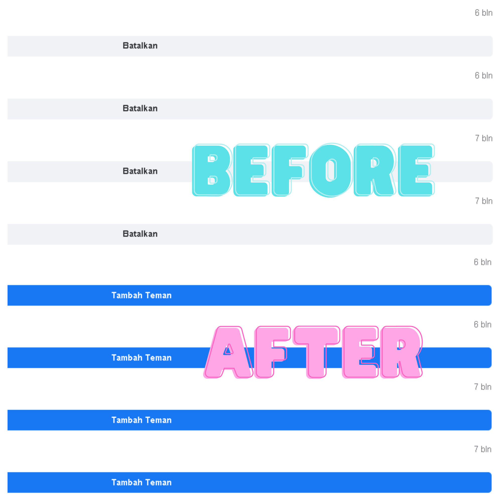

# Unsend All Friend Requests via PC / Laptop

## Description

Unsend All Friend Requests is a tiny JavaScript snippet that cancels all of your sent Facebook friend requests in one go, straight from your PC or laptop browser. If you have ever sent friend requests that were never accepted and now have a long list of pending requests piling up, this script cleans them all up for you in seconds.

There is nothing to install and nothing to sign up for. You just open Facebook's outgoing friend requests page, paste the script into your browser's developer console, and press Enter. The script automatically finds every "Cancel Request" button on the page and clicks them one by one, so every pending request you have scrolled into view gets withdrawn without you having to cancel them manually one at a time.

## What it does

- Cancels all sent (outgoing) Facebook friend requests that are loaded on the page at once.
- Runs entirely in your own browser through the developer console (F12), no extensions or software needed.
- Does not ask for your password, token, or any account access, the script only clicks the cancel buttons that are already on your screen.
- Free to use and easy to repeat whenever your pending requests pile up again.

## How to use

- Click https://m.facebook.com/friends/center/requests/outgoing/#friends_center_main
- Scroll down until it's stuck
- Press F12
- Paste the script then enter
-Done

script: https://github.com/xsrazy/Unsend-All-Friend-Requests/blob/main/script.txt

